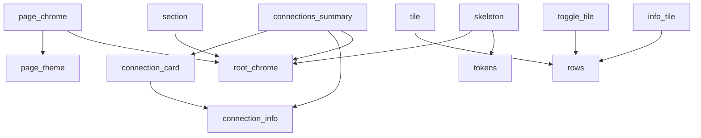

# Settings widgets dependency and wiring report

Original formatted reference R `0eadeb8c516b55445a367f1885136a7cf4be2312`. Generated from analyzer declarations, scanner tokens and parsed import directives; relative and package URIs resolved lexically within this checkout. No production caller is edited in Step 0.

60 declarations, 47 public names, 13 private declarations/variables; 132 importing files (117 lib, 15 test, 14 runnable). No prefix or hide directive. Public names remain reachable through the planned facade; the source reader and surface test pin every name.

## Declaration ownership and cross-file references

| Declaration | Destination | Cross-file public references | State reads | Comment fragments |
| --- | --- | --- | --- | --- |
| `kSettingsBg` | `settings_tokens.dart` | — | — | 6; retained with this leaf |
| `kSettingsAccent` | `settings_tokens.dart` | — | — | 0; retained with this leaf |
| `kSettingsAccent2` | `settings_tokens.dart` | — | — | 0; retained with this leaf |
| `kSettingsPanel` | `settings_tokens.dart` | — | — | 0; retained with this leaf |
| `kSettingsPanel2` | `settings_tokens.dart` | — | — | 0; retained with this leaf |
| `kSettingsGreen` | `settings_tokens.dart` | — | — | 0; retained with this leaf |
| `kSettingsRed` | `settings_tokens.dart` | — | — | 0; retained with this leaf |
| `kSettingsAmber` | `settings_tokens.dart` | — | — | 0; retained with this leaf |
| `kSettingsLine` | `settings_tokens.dart` | — | — | 1; retained with this leaf |
| `kSettingsDim` | `settings_tokens.dart` | — | — | 0; retained with this leaf |
| `kSettingsDim2` | `settings_tokens.dart` | — | — | 0; retained with this leaf |
| `kSettingsMaxWidth` | `settings_tokens.dart` | — | — | 2; retained with this leaf |
| `WebDavSyncPendingBadge` | `settings_pending_badge.dart` | — | —; context | 0; retained with this leaf |
| `settingsInitialsFor` | `settings_connection_card.dart` | — | — | 4; retained with this leaf |
| `SettingsRowContent` | `settings_rows.dart` | — | — | 5; retained with this leaf |
| `SettingsRows` | `settings_rows.dart` | — | — | 34; retained with this leaf |
| `launchSettingsUrl` | `settings_links.dart` | — | — | 1; retained with this leaf |
| `settingsPageTheme` | `settings_page_theme.dart` | — | —; context | 10; retained with this leaf |
| `_settingsThemeBase` | `settings_page_theme.dart` | — | — | 0; retained with this leaf |
| `_settingsThemeApp` | `settings_page_theme.dart` | — | — | 0; retained with this leaf |
| `_settingsThemeCache` | `settings_page_theme.dart` | — | — | 0; retained with this leaf |
| `_buildSettingsPageTheme` | `settings_page_theme.dart` | — | — | 14; retained with this leaf |
| `pushSettingsPage` | `settings_page_theme.dart` | — | —; context | 7; retained with this leaf |
| `showSettingsDialog` | `settings_page_theme.dart` | — | —; context | 3; retained with this leaf |
| `SettingsPageScaffold` | `settings_page_chrome.dart` | `SettingsBackground`, `settingsPageTheme` | —; context | 5; retained with this leaf |
| `SettingsPageHeader` | `settings_page_chrome.dart` | — | —; context | 4; retained with this leaf |
| `SettingsBannerTone` | `settings_page_chrome.dart` | — | — | 2; retained with this leaf |
| `SettingsInfoBanner` | `settings_page_chrome.dart` | — | —; context | 0; retained with this leaf |
| `SettingsBackground` | `settings_root_chrome.dart` | — | —; context | 5; retained with this leaf |
| `SettingsHeader` | `settings_root_chrome.dart` | — | —; context | 4; retained with this leaf |
| `SettingsSectionLabel` | `settings_root_chrome.dart` | — | —; context | 1; retained with this leaf |
| `ConnectionInfo` | `settings_connection_info.dart` | — | — | 0; retained with this leaf |
| `settingsConnectionNeedsAttention` | `settings_connection_info.dart` | — | — | 5; retained with this leaf |
| `settingsConnectionIsReady` | `settings_connection_info.dart` | — | — | 0; retained with this leaf |
| `ConnectionsSummary` | `settings_connections_summary.dart` | `ConnectionInfo` | — | 1; retained with this leaf |
| `_ConnectionsSummaryState` | `settings_connections_summary.dart` | `ConnectionCard`, `SettingsSectionLabel` | widget: allDebrid, firstCardFocusNode, indexerManagers, iptv, mdblist, mediaServers, pikpak, premiumize, realDebrid, simkl, torbox, tracking, trakt, webDav; context | 29; retained with this leaf |
| `ConnectionCard` | `settings_connection_card.dart` | `ConnectionInfo` | — | 6; retained with this leaf |
| `_ConnectionCardState` | `settings_connection_card.dart` | `settingsConnectionIsReady` | widget: downNeighbor, focusNode, info, isLeftColumn, leftNeighbor, rightNeighbor, upNeighbor; context | 16; retained with this leaf |
| `SettingsSection` | `settings_section.dart` | `SettingsSectionLabel` | —; context | 17; retained with this leaf |
| `SettingsLookHero` | `settings_look_hero.dart` | — | — | 5; retained with this leaf |
| `_SettingsLookHeroState` | `settings_look_hero.dart` | — | widget: focusNode, label, onTap, subtitle; context | 1; retained with this leaf |
| `_SettingsSwatches` | `settings_look_hero.dart` | — | —; context | 0; retained with this leaf |
| `SettingsTile` | `settings_tile.dart` | `SettingsRowContent` | — | 12; retained with this leaf |
| `_SettingsTileState` | `settings_tile.dart` | — | widget: destructive, enabled, focusNode, icon, onTap, subtitle, tag, title, trailing; context | 30; retained with this leaf |
| `SettingsToggleTile` | `settings_toggle_tile.dart` | `SettingsRowContent` | — | 2; retained with this leaf |
| `_SettingsToggleTileState` | `settings_toggle_tile.dart` | — | widget: focusNode, icon, onChanged, subtitle, subtitleMaxLines, title, value; context | 4; retained with this leaf |
| `TvUiScaleChoice` | `settings_tv_choices.dart` | — | — | 9; retained with this leaf |
| `kTvUiScaleChoices` | `settings_tv_choices.dart` | — | — | 0; retained with this leaf |
| `tvUiScaleLabel` | `settings_tv_choices.dart` | — | — | 2; retained with this leaf |
| `TvRenderQualityChoice` | `settings_tv_choices.dart` | — | — | 1; retained with this leaf |
| `kTvRenderQualityChoices` | `settings_tv_choices.dart` | — | — | 4; retained with this leaf |
| `tvRenderQualityLabel` | `settings_tv_choices.dart` | — | — | 2; retained with this leaf |
| `SettingsSelectOption` | `settings_select_dropdown.dart` | — | — | 1; retained with this leaf |
| `SettingsSelectDropdown` | `settings_select_dropdown.dart` | — | —; context | 16; retained with this leaf |
| `SettingsInfoTile` | `settings_info_tile.dart` | `SettingsRowContent` | —; context | 2; retained with this leaf |
| `SettingsSkeleton` | `settings_skeleton.dart` | `SettingsBackground`, `kSettingsMaxWidth` | —; context | 1; retained with this leaf |
| `_SkeletonHeader` | `settings_skeleton.dart` | — | —; context | 0; retained with this leaf |
| `_SkeletonSection` | `settings_skeleton.dart` | — | —; context | 0; retained with this leaf |
| `_SkeletonTile` | `settings_skeleton.dart` | — | —; context | 0; retained with this leaf |
| `showLegacyModeInfoDialog` | `settings_legacy_mode_dialog.dart` | — | —; context | 9; retained with this leaf |

Every doc and interior comment stays with its exact analyzer leaf. The comment inventory below is complete, including ordinary prose and private-name doc links; these links are never renamed. Whitespace-only gaps contain no unowned comment fragment.

### `kSettingsBg` comments

```dart
/// Shared visual tokens for the Settings screens.
///
/// These mirror the Stremio board constants in `search_screen.dart`
/// (`kStremioBg` / `kStremioAccent`) and `see_all_theme.dart` so Settings
/// finally matches the Discover look. Duplicated on purpose — importing
/// `search_screen.dart` from here would be a layering smell.
```

### `kSettingsLine` comments

```dart
/// Thin hairline used for panel borders and row dividers.
```

### `kSettingsMaxWidth` comments

```dart
/// Max content width for the settings column so it doesn't stretch
/// edge-to-edge on TV/desktop.
```

### `settingsInitialsFor` comments

```dart
/// Uniform monochrome initials chip for a connection provider ("RD", "JP").
/// Replaces the old per-provider colored gradient icon boxes — status is
/// carried by the dot/text instead, keeping the chrome calm like Stremio.
// Single word: prefer internal capitals (AllDebrid → AD, PikPak → PP).
```

### `SettingsRowContent` comments

```dart
/// Icon + copy for one settings row. Defined once in [SettingsRows] and
/// consumed by BOTH the phone single-column layout and the TV two-pane layout
/// (via `SettingsTile.spec` / `SettingsToggleTile.spec`) so the two can't
/// drift — change a title/icon here and both surfaces update.
/// External link for community rows (Reddit/Discord/GitHub).
```

### `SettingsRows` comments

```dart
/// Single source of truth for every settings row's icon + copy.
// The Profiles hub replaced the bare switch action: switching lives on the
// hub beside the roster, so this row is now the one front door. It heads
// the Profiles SECTION now (its own card, not a Devices tenant), with the
// two most-wanted actions surfaced beside it as rows of their own.
// Subtitle is dynamic (the chosen size) — passed per call site.
// Subtitle is dynamic (the chosen mode) — passed per call site.
// Subtitle is dynamic (the chosen layout) — passed per call site.
// Subtitle is dynamic (the chosen layout) — passed per call site.
// Subtitle is dynamic (the chosen style) — passed per call site.
// The desktop/tablet counterpart — never shown beside the TV row (each is
// platform-gated), so the shared title is unambiguous wherever it appears.
// Subtitle is dynamic (the chosen brightness) — passed per call site.
// Subtitle is dynamic (the chosen ident) — passed per call site.
// Subtitle is dynamic (the chosen style) — passed per call site.
// Subtitle is dynamic (the chosen style) — passed per call site.
// Subtitle is dynamic (style + palette) — passed per call site.
// Subtitle is dynamic (the chosen skin) — passed per call site. Android
// TV only: the native player's control skin (OTT dock vs Legacy).
// Subtitle is dynamic (the chosen style) — passed per call site. Android
// TV only: the Debrify TV playback screen (native TorboxTvPlayerActivity).
// Subtitle is dynamic (the chosen look) — passed per call site.
// Subtitle is dynamic (the chosen style) — passed per call site.
// Subtitle is dynamic (the chosen layout) — passed per call site.
// Subtitle is dynamic (the active Look, or "Custom") — passed per call site.
/// Sits directly under Looks, in the same section. It was reachable only by
/// opening Looks first, which put the entire token layer two levels down
/// behind a row that gave no hint it was there.
// Just 'Theme': the section header above it already says THEME, and
// 'App Theme' only ever needed the qualifier to tell itself apart from
// the Details Theme row that no longer exists.
// Subtitle is dynamic (the chosen presentation) — passed per call site.
// Subtitle is dynamic (current folder) — passed per call site.
// Subtitle is dynamic (update status) — passed per call site.
```

### `launchSettingsUrl` comments

```dart
/// Opens a settings community link. Shared so both layouts launch the same URL.
```

### `settingsPageTheme` comments

```dart
/// Scoped theme for the settings subpages: re-tints every Material widget
/// (inputs, buttons, cards, switches, dialogs, tabs, snackbars…) to the
/// Stremio purple palette so pages restyle wholesale without touching their
/// widget code. Wrap a page's Scaffold in `Theme(data: settingsPageTheme(...))`
/// — or just use [SettingsPageScaffold], which does it for you.
// Memoized: the theme is a pure transform of its two inputs, and rebuilding
// ~25 sub-theme objects on every page build — including every focus-move
// setState on TV — is pure waste. BOTH inputs key the cache: a frozen
// boundary can hand us a legacy ThemeData under a themed app profile (and
// vice versa), so identity on `base` alone would serve a stale palette.
```

### `_buildSettingsPageTheme` comments

```dart
// Primary text follows the BASE theme, not a hardcoded white: the base
// carries the Appearance → Text Brightness preset in its onSurface (white
// on Bright, so nothing changes there). On-accent colors take `onAccent`,
// NOT page ink: a label on a FILLED swatch is decided by the swatch, and
// under legacy that resolves to the same white this used to hardcode.
// Against the SETTINGS accent — the swatch these controls are actually
// filled with, which under legacy is violet rather than the core's olive.
// Disabled states must stay visually distinct (grayed) or users can't
// tell an inert toggle from an active one — see the hide-from-nav
// switches, which are disabled until the provider is logged in.
// The thumb sits ON the track, so SELECTED (an accent track) takes
// on-accent ink; unselected rides a faint neutral track, where page
// ink is right. Under legacy both resolve to white, as before.
// Rides the ACTIVE (accent) track.
```

### `pushSettingsPage` comments

```dart
/// Pushes a settings subpage wrapped in [settingsPageTheme].
///
/// The wrap must happen at the ROUTE level, not just inside the page:
/// `showDialog` captures InheritedThemes from the *calling* context (the
/// page State's context, which sits above anything the page builds). With
/// the theme applied here, every dialog a settings page opens inherits the
/// purple palette automatically.
```

### `showSettingsDialog` comments

```dart
/// showDialog wrapper that applies [settingsPageTheme] to the dialog even
/// when called from a context above the scoped theme (e.g. the root
/// settings screen, which is a tab, not a pushed settings route).
```

### `SettingsPageScaffold` comments

```dart
/// Standard scaffold for every settings subpage: applies [settingsPageTheme],
/// paints the [SettingsBackground] wash under a transparent AppBar, and keeps
/// the page's own body/scroll untouched.
// AppBar chrome (transparent bg, zero elevation) comes from
// settingsPageTheme.appBarTheme — single source of truth.
```

### `SettingsPageHeader` comments

```dart
/// Flat page hero for subpages: accent-tinted icon chip + title + subtitle.
/// Replaces the old gradient `primaryContainer` header cards.
// No color: inherits the ambient bodyMedium color, which is
// onSurface — and so follows Appearance → Text Brightness.
```

### `SettingsBannerTone` comments

```dart
/// Quiet informational banner (replaces the old secondaryContainer info
/// boxes). [tone] tints it: accent (default), warning amber, or danger red.
```

### `SettingsBackground` comments

```dart
/// Full-bleed settings room.
///
/// The vertical ground-to-pane walk is the same stage used by onboarding.
/// A restrained accent bloom gives themed Looks their identity without
/// returning to the old purple wash that sat behind every theme.
```

### `SettingsHeader` comments

```dart
/// Backwards-compatible root header used by loading and search surfaces.
/// New responsive roots use [SettingsRootHeader] from the Spotlight shell.
// No color: inherits onSurface via the ambient DefaultTextStyle,
// so it follows Appearance → Text Brightness.
```

### `SettingsSectionLabel` comments

```dart
/// Quiet uppercase section label ("CONNECTIONS", "GENERAL", …).
```

### `settingsConnectionNeedsAttention` comments

```dart
/// Whether a configured connection is explicitly reporting a degraded state.
///
/// Providers use a few healthy labels (for example `Active` and `Configured`),
/// so treating every non-`Active` value as an error incorrectly marks Jackett
/// and Prowlarr as unhealthy. Only known negative states need intervention.
```

### `ConnectionsSummary` comments

```dart
// Null when MDBList is hidden (alpha) — its card + focus node are then omitted.
```

### `_ConnectionsSummaryState` comments

```dart
// Focus nodes for grid navigation
// Layout (wide) — the Reddit card is hidden (source retired), its
// ConnectionInfo/focus node are kept so nothing else has to change:
// [realDebrid,  torbox]
// [premiumize,  allDebrid]
// [pikpak,      webDav]
// [indexerManagers, iptv]
// [tracking policy]      (full width)
// [trakt,       simkl]
// [mdblist]     (alone)
// Grid layout (wide) — Reddit card hidden, source retired:
// [RD]         [Torbox]
// [Premiumize] [AllDebrid]
// [PikPak]     [WebDAV]
// [Indexers]   [IPTV]
// ── Tracking ──
// [cross-service policy]
// ── Tracker services ──
// [Trakt]       [Simkl]
// [MDBList]
//
// Row 1: Real Debrid (left), Torbox (right)
// Row 2: Premiumize (left), AllDebrid (right)
// Row 3: PikPak (left), WebDAV (right)
// Row 4: Indexer managers (left), IPTV (right).
// (The retired Reddit source's card, params and focus
// node were removed with its orphaned settings page.)
// Row 1: Trakt (left), Simkl (right).
// Row 2: MDBList (left, when enabled).
```

### `ConnectionCard` comments

```dart
/// Flat provider row: mono initials chip · name + caption · status dot + text
/// · chevron. Focus/hover paints the accent ring, Stremio-style.
///
/// The manual DPAD neighbor wiring (and the sidebar hand-off on left from the
/// left column) is preserved verbatim from the original card — do not swap it
/// for default traversal without testing on real TV hardware.
```

### `_ConnectionCardState` comments

```dart
/// The wrapper's own node, so focus can be read rather than remembered —
/// see the note on `_SettingsTileState._focused`.
/// Live, never cached. `hasFocus` is DESCENDANT-inclusive, so this wrapper
/// reads true while the card's own InkWell below it holds focus — which is
/// the intent, and the same value `Focus.onFocusChange` used to deliver.
/// The theme's tempo, resolved in the one hook that may depend on inherited
/// widgets and still re-runs when they change. The reveal below fires from a
/// key handler, which is no place for a scope lookup.
// Helper to focus and scroll into view
// Left column with no left neighbor: open sidebar
// One color for both the dot and the status text so they can't disagree.
// hasFocus includes the InkWell child node, so this lights up when the
// card's InkWell receives DPAD focus.
// Plain Container (snap, no tween): animating a blurred BoxShadow
// re-rasterizes per frame and janks weak TV GPUs (see
// tv_sidebar_nav.dart for the same rule).
```

### `SettingsSection` comments

```dart
/// Flat panel section: quiet uppercase label above a bordered panel of rows
/// separated by hairlines.
/// One line under the header saying what the rows below have in common.
///
/// Optional because most sections are self-evident from their title. It
/// earns its place where a group's rows LOOK like their neighbours but
/// answer a different question — Appearance's performance rows next to its
/// style rows being the case that prompted it.
// The `settingsGroup` family, and the reason it is capped to fill-or-rule:
// this is ONE filled container whose rows have zero inter-row gap and an
// in-place `Border.all`. Dropping both would shift every row by a pixel
// and dissolve the grouping into an undifferentiated stack — so `space`
// and `glass` are not on offer, and a look that asks for either is
// clamped to `rule` by `modelFor` before it reaches here.
// A rule look keeps the border — that IS its separation — and
// loses only the fill. The border width is unchanged either way,
// which is what keeps the row geometry identical.
```

### `SettingsLookHero` comments

```dart
/// Prominent active-Look row used at the top of Appearance.
///
/// A Look changes several downstream controls at once, so presenting it as
/// one more 52dp row understated its effect and made Appearance read as an
/// arbitrary list. The swatches are derived from the active theme itself.
```

### `_SettingsLookHeroState` comments

```dart
/// Live, never cached — see the note on `_SettingsTileState._focused`.
```

### `SettingsTile` comments

```dart
/// Flat settings row: mono icon · title + subtitle · chevron (or custom
/// trailing). Focus/hover lights the row with the accent ring so DPAD focus
/// is unmissable on TV.
/// Renders the icon and title in the destructive red (Danger Zone).
/// False greys the whole row out and makes it inert: no tap, no hover
/// light, and DPAD traversal skips it. The subtitle stays readable — a
/// disabled row should say WHY it's disabled (e.g. "Only used by the
/// Spotlight layout") rather than vanish.
/// Lets a parent (e.g. the TV two-pane rail) drive focus onto this row.
/// Build from a shared [SettingsRowContent] so the TV and phone layouts
/// stay in lockstep. [subtitle] overrides the content's (for dynamic rows
/// like "Check for Updates").
```

### `_SettingsTileState` comments

```dart
/// Owned only when the caller did not supply one.
/// Read LIVE from the node, never cached from `onFocusChange`.
///
/// A cached bool is only as good as the callback that maintains it, and
/// Flutter does not guarantee the falling edge: pop a route that was opened
/// with OK and focus is restored to the MODAL SCOPE rather than to a row, so
/// the rows that were focus-walked on the way in are never told they lost
/// it. They keep their cached `true`, and under the Spotlight look that is
/// not a faint stale highlight — every one of them paints a solid white
/// plate, so the list comes back from a sub-page with two or three cursors
/// on it and no way to tell which row OK will open.
///
/// Derived state cannot go stale the way a remembered one does: the value is
/// re-read on every build, so it is only ever as old as the last rebuild
/// rather than as old as the last callback that arrived.
///
/// Being precise about what that does and does not buy, because the
/// difference matters if this is ever revisited: the repaint trigger is
/// still the same `onFocusChange` the bug rides on, so a silently-missed
/// notification leaves the WRONG PIXELS up until something rebuilds this
/// row — it does not repaint it the instant focus leaves. What reliably
/// rebuilds it is the row's own `onTap` being awaited below: callers
/// setState when the pushed page returns, which rebuilds the list with
/// fresh values. (A route transition alone would NOT do it — ModalScope
/// caches the page subtree behind its AnimatedBuilder's `child`.)
// Snap, don't tween — per-keypress decoration lerps add cost on TV.
// Also drops the row out of DPAD traversal — an unfocusable node
// never enters the traversal ring, so no remote step is eaten.
// One veil for the whole anatomy (icon, tag chip, chevron) rather
// than per-part disabled colors that would drift out of sync.
```

### `SettingsToggleTile` comments

```dart
/// Flat toggle row — same anatomy as [SettingsTile] with a switch on the
/// right instead of a chevron.
```

### `_SettingsToggleTileState` comments

```dart
/// Live, never cached — see the note on `_SettingsTileState._focused`.
// Snap, don't tween — per-keypress decoration lerps add cost on TV.
// The row's InkWell is the single DPAD stop; a focusable
// Switch would make every toggle cost two presses on TV.
```

### `TvUiScaleChoice` comments

```dart
/// One Android TV "Screen Size" choice. [percent] is the share of the panel's
/// native density the UI is laid out at — smaller means a wider logical canvas,
/// so the same layouts draw smaller and more fits on screen. Values must stay in
/// step with `StorageService.kTvUiScaleOptions`; the shipped default is
/// `StorageService.kTvUiScaleDefault`.
///
/// Lives here (not in the TV settings shell) because two surfaces render it:
/// the TV Mode rail row's caption and the Screen Size page itself.
/// "Compact (80%)" — the row caption and the page's selected label.
```

### `tvUiScaleLabel` comments

```dart
/// Caption for [percent], falling back to the raw value if a stored size is
/// ever outside the offered set.
```

### `TvRenderQualityChoice` comments

```dart
/// One entry in the Android TV "Rendering" picker.
```

### `kTvRenderQualityChoices` comments

```dart
/// Automatic first: it's the default, and it's the only option that leaves the
/// device-capability call intact. The other two are named for the TRADE, not
/// for the mechanism — nobody browsing settings knows what a render buffer is,
/// but everybody knows which of "sharper" and "smoother" they want right now.
```

### `tvRenderQualityLabel` comments

```dart
/// Caption for [quality] — the settings row's subtitle and the picker's
/// selected label.
```

### `SettingsSelectOption` comments

```dart
/// One choice inside a [SettingsSelectDropdown].
```

### `SettingsSelectDropdown` comments

```dart
/// Single-choice dropdown for settings cards — replaces the old
/// RadioListTile stacks (Post-Torrent Action, File Selection, …).
///
/// DPAD notes: the closed field is one focusable node (focus ring comes from
/// the themed `focusedBorder`); OK opens the menu, whose items take DPAD
/// focus natively, and BACK dismisses it. The selected option's subtitle is
/// echoed under the field so the descriptive copy isn't lost when closed.
// A stale stored value (e.g. removed option) renders as an empty
// field instead of tripping DropdownButton's value assert.
// Variable item heights so subtitles fit in the open menu.
// No focusColor: with an InputDecoration the SDK swaps the fill
// color for it on focus, which would blank the panel fill. Focus
// is carried by the themed focusedBorder instead.
// Explicit color (not inherit): the dropdown renders its menu items
// with this style directly, outside the page's DefaultTextStyle.
// Closed field shows just the title; the subtitle lives below.
```

### `SettingsInfoTile` comments

```dart
/// Non-interactive key/value row (e.g. Version).
// No color: inherits onSurface (Text Brightness).
```

### `SettingsSkeleton` comments

```dart
/// Loading skeleton, restyled to the flat Stremio panels.
```

### `showLegacyModeInfoDialog` comments

```dart
/// The "why is this install in legacy mode" dialog, opened from the Profiles
/// row on every settings layout.
///
/// This dialog IS the bug report. The one channel a television reporter
/// reliably has is a phone photo of the screen, so the captured reason —
/// including the error and its first stack frame on the unpredicted path —
/// is shown in full here rather than summarized. The reassurance lines are
/// as load-bearing as the diagnosis: legacy mode looks like data loss from
/// the couch, and it is precisely the opposite.
```

## Service and platform imports

| File | Narrow import | Exit milestone |
| --- | --- | --- |
| settings_connection_card.dart | services/main_page_bridge.dart show MainPageBridge | composition-injected sidebar focus callback |
| settings_legacy_mode_dialog.dart | services/profiles/profile_bootstrap.dart show ProfileBootstrap | composition-injected legacy reason |
| settings_links.dart | package:url_launcher/url_launcher.dart | composition-wired launcher port |

No other service/native operation is introduced. Original imports retain their unshown form in Step 0. Destinations use only the exact shows after creation.

## Public-reference import DAG



The graph is acyclic. No cross-file private reference exists, so type_aliases is empty. Sorted imports are generated by `settings_widgets_probe.py`; the split probe analyzes exactly these files under feature strict options.

## Importing callers

| Importer | Used facade names | Import directive |
| --- | --- | --- |
| `lib/features/iptv_settings/presentation/iptv_settings_dialog_button_style.dart` | `kSettingsAccent` | `import 'package:debrify/screens/settings/widgets/settings_widgets.dart';` |
| `lib/features/iptv_settings/presentation/legacy_iptv_settings/iptv_settings_catalog_actions.dart` | `pushSettingsPage` | `import 'package:debrify/screens/settings/widgets/settings_widgets.dart';` |
| `lib/features/iptv_settings/presentation/legacy_iptv_settings/iptv_settings_category_views.dart` | none (original unused import) | `import 'package:debrify/screens/settings/widgets/settings_widgets.dart';` |
| `lib/features/iptv_settings/presentation/legacy_iptv_settings/iptv_settings_file_import.dart` | `settingsPageTheme` | `import 'package:debrify/screens/settings/widgets/settings_widgets.dart';` |
| `lib/features/iptv_settings/presentation/legacy_iptv_settings/iptv_settings_list_views.dart` | none (original unused import) | `import 'package:debrify/screens/settings/widgets/settings_widgets.dart';` |
| `lib/features/iptv_settings/presentation/legacy_iptv_settings/iptv_settings_phone_hub.dart` | `SettingsSection`, `SettingsTile` | `import 'package:debrify/screens/settings/widgets/settings_widgets.dart';` |
| `lib/features/iptv_settings/presentation/legacy_iptv_settings/iptv_settings_preferences_actions.dart` | `pushSettingsPage` | `import 'package:debrify/screens/settings/widgets/settings_widgets.dart';` |
| `lib/features/iptv_settings/presentation/legacy_iptv_settings/iptv_settings_preferences_views.dart` | none (original unused import) | `import 'package:debrify/screens/settings/widgets/settings_widgets.dart';` |
| `lib/features/iptv_settings/presentation/legacy_iptv_settings/iptv_settings_recording_view.dart` | none (original unused import) | `import 'package:debrify/screens/settings/widgets/settings_widgets.dart';` |
| `lib/features/iptv_settings/presentation/legacy_iptv_settings/iptv_settings_root_layout.dart` | `SettingsPageScaffold` | `import 'package:debrify/screens/settings/widgets/settings_widgets.dart';` |
| `lib/features/iptv_settings/presentation/legacy_iptv_settings/iptv_settings_source_edit.dart` | `settingsPageTheme` | `import 'package:debrify/screens/settings/widgets/settings_widgets.dart';` |
| `lib/features/iptv_settings/presentation/legacy_iptv_settings/iptv_settings_source_views.dart` | none (original unused import) | `import 'package:debrify/screens/settings/widgets/settings_widgets.dart';` |
| `lib/features/playback_settings/presentation/legacy_playback_settings/playback_external_section.dart` | `SettingsInfoBanner` | `import 'package:debrify/screens/settings/widgets/settings_widgets.dart';` |
| `lib/features/playback_settings/presentation/legacy_playback_settings/playback_ios_section.dart` | `SettingsInfoBanner` | `import 'package:debrify/screens/settings/widgets/settings_widgets.dart';` |
| `lib/features/playback_settings/presentation/legacy_playback_settings/playback_linux_section.dart` | `SettingsInfoBanner` | `import 'package:debrify/screens/settings/widgets/settings_widgets.dart';` |
| `lib/features/playback_settings/presentation/legacy_playback_settings/playback_mac_section.dart` | `SettingsInfoBanner` | `import 'package:debrify/screens/settings/widgets/settings_widgets.dart';` |
| `lib/features/playback_settings/presentation/legacy_playback_settings/playback_player_appearance.dart` | `SettingsRows`, `SettingsSection`, `SettingsTile`, `pushSettingsPage` | `import 'package:debrify/screens/settings/widgets/settings_widgets.dart';` |
| `lib/features/playback_settings/presentation/legacy_playback_settings/playback_settings_layout.dart` | `SettingsInfoBanner`, `SettingsPageHeader`, `SettingsPageScaffold`, `SettingsSection`, `SettingsTile`, `kSettingsMaxWidth` | `import 'package:debrify/screens/settings/widgets/settings_widgets.dart';` |
| `lib/features/playback_settings/presentation/legacy_playback_settings/playback_subtitle_section.dart` | `SettingsSection`, `SettingsTile`, `pushSettingsPage` | `import 'package:debrify/screens/settings/widgets/settings_widgets.dart';` |
| `lib/features/playback_settings/presentation/legacy_playback_settings/playback_vr_section.dart` | `SettingsInfoBanner` | `import 'package:debrify/screens/settings/widgets/settings_widgets.dart';` |
| `lib/features/playback_settings/presentation/legacy_playback_settings/playback_windows_section.dart` | `SettingsInfoBanner` | `import 'package:debrify/screens/settings/widgets/settings_widgets.dart';` |
| `lib/features/settings/presentation/legacy_settings/search_index/settings_index_builder.dart` | none (original unused import) | `import 'package:debrify/screens/settings/widgets/settings_widgets.dart';` |
| `lib/features/settings/presentation/legacy_settings/search_index/settings_index_slice_01.dart` | `SettingsRows` | `import 'package:debrify/screens/settings/widgets/settings_widgets.dart';` |
| `lib/features/settings/presentation/legacy_settings/search_index/settings_index_slice_03.dart` | `SettingsRows` | `import 'package:debrify/screens/settings/widgets/settings_widgets.dart';` |
| `lib/features/settings/presentation/legacy_settings/search_index/settings_index_slice_04.dart` | `SettingsRows`, `kTvRenderQualityChoices`, `kTvUiScaleChoices`, `tvRenderQualityLabel`, `tvUiScaleLabel` | `import 'package:debrify/screens/settings/widgets/settings_widgets.dart';` |
| `lib/features/settings/presentation/legacy_settings/search_index/settings_index_slice_05.dart` | `SettingsRows` | `import 'package:debrify/screens/settings/widgets/settings_widgets.dart';` |
| `lib/features/settings/presentation/legacy_settings/search_index/settings_index_slice_06.dart` | `SettingsRows` | `import 'package:debrify/screens/settings/widgets/settings_widgets.dart';` |
| `lib/features/settings/presentation/legacy_settings/search_index/settings_index_slice_07.dart` | `SettingsRows` | `import 'package:debrify/screens/settings/widgets/settings_widgets.dart';` |
| `lib/features/settings/presentation/legacy_settings/search_index/settings_index_slice_08.dart` | `SettingsRows` | `import 'package:debrify/screens/settings/widgets/settings_widgets.dart';` |
| `lib/features/settings/presentation/legacy_settings/search_index/settings_index_slice_09.dart` | `SettingsRows` | `import 'package:debrify/screens/settings/widgets/settings_widgets.dart';` |
| `lib/features/settings/presentation/legacy_settings/search_index/settings_index_slice_10.dart` | `SettingsRows` | `import 'package:debrify/screens/settings/widgets/settings_widgets.dart';` |
| `lib/features/settings/presentation/legacy_settings/search_index/settings_index_slice_11.dart` | `SettingsRows`, `launchSettingsUrl` | `import 'package:debrify/screens/settings/widgets/settings_widgets.dart';` |
| `lib/features/settings/presentation/legacy_settings/search_index/settings_leaf_slice_05.dart` | `pushSettingsPage` | `import 'package:debrify/screens/settings/widgets/settings_widgets.dart';` |
| `lib/features/settings/presentation/legacy_settings/search_index/settings_search_index.dart` | none (original unused import) | `import 'package:debrify/screens/settings/widgets/settings_widgets.dart';` |
| `lib/features/settings/presentation/legacy_settings/settings_appearance_navigation.dart` | `pushSettingsPage` | `import 'package:debrify/screens/settings/widgets/settings_widgets.dart';` |
| `lib/features/settings/presentation/legacy_settings/settings_backup.dart` | `showSettingsDialog` | `import 'package:debrify/screens/settings/widgets/settings_widgets.dart';` |
| `lib/features/settings/presentation/legacy_settings/settings_connection_navigation.dart` | `pushSettingsPage` | `import 'package:debrify/screens/settings/widgets/settings_widgets.dart';` |
| `lib/features/settings/presentation/legacy_settings/settings_connections.dart` | `ConnectionInfo` | `import 'package:debrify/screens/settings/widgets/settings_widgets.dart';` |
| `lib/features/settings/presentation/legacy_settings/settings_layout_composition.dart` | `ConnectionsSummary`, `tvRenderQualityLabel` | `import 'package:debrify/screens/settings/widgets/settings_widgets.dart';` |
| `lib/features/settings/presentation/legacy_settings/settings_maintenance.dart` | `showSettingsDialog` | `import 'package:debrify/screens/settings/widgets/settings_widgets.dart';` |
| `lib/features/settings/presentation/legacy_settings/settings_page_navigation.dart` | `pushSettingsPage`, `settingsPageTheme` | `import 'package:debrify/screens/settings/widgets/settings_widgets.dart';` |
| `lib/features/settings/presentation/legacy_settings/settings_profile_actions.dart` | `pushSettingsPage` | `import 'package:debrify/screens/settings/widgets/settings_widgets.dart';` |
| `lib/features/settings/presentation/legacy_settings/settings_restore.dart` | `showSettingsDialog` | `import 'package:debrify/screens/settings/widgets/settings_widgets.dart';` |
| `lib/features/settings/presentation/legacy_settings/settings_search_navigation.dart` | `pushSettingsPage` | `import 'package:debrify/screens/settings/widgets/settings_widgets.dart';` |
| `lib/features/settings/presentation/settings_classic_layout.dart` | `SettingsBackground`, `SettingsInfoTile`, `SettingsRows`, `SettingsSection`, `SettingsTile`, `SettingsToggleTile`, `kSettingsMaxWidth`, `launchSettingsUrl` | `import 'package:debrify/screens/settings/widgets/settings_widgets.dart';` |
| `lib/features/settings/presentation/settings_connection_grid.dart` | `ConnectionCard` | `import 'package:debrify/screens/settings/widgets/settings_widgets.dart';` |
| `lib/features/settings/presentation/settings_layout.dart` | none (original unused import) | `import 'package:debrify/screens/settings/widgets/settings_widgets.dart';` |
| `lib/features/settings/presentation/settings_spotlight_category.dart` | `SettingsInfoTile`, `SettingsLookHero`, `SettingsRowContent`, `SettingsRows`, `SettingsSection`, `SettingsTile`, `SettingsToggleTile`, `launchSettingsUrl`, `showLegacyModeInfoDialog` | `import 'package:debrify/screens/settings/widgets/settings_widgets.dart';` |
| `lib/features/settings/presentation/settings_spotlight_layout.dart` | `settingsConnectionIsReady`, `settingsConnectionNeedsAttention` | `import 'package:debrify/screens/settings/widgets/settings_widgets.dart';` |
| `lib/main.dart` | `pushSettingsPage` | `import 'screens/settings/widgets/settings_widgets.dart' show pushSettingsPage;` |
| `lib/screens/collections/collection_editor_screen.dart` | `settingsPageTheme` | `import '../settings/widgets/settings_widgets.dart';` |
| `lib/screens/settings/alldebrid_settings_page.dart` | `SettingsBannerTone`, `SettingsInfoBanner`, `SettingsPageScaffold`, `SettingsSelectDropdown`, `SettingsSelectOption`, `kSettingsMaxWidth` | `import 'widgets/settings_widgets.dart';` |
| `lib/screens/settings/app_theme_page.dart` | `SettingsSectionLabel` | `import 'widgets/settings_widgets.dart' show SettingsSectionLabel;` |
| `lib/screens/settings/collections_settings_page.dart` | `SettingsPageScaffold`, `SettingsSection`, `SettingsSelectDropdown`, `SettingsSelectOption`, `SettingsTile`, `SettingsToggleTile`, `kSettingsMaxWidth`, `settingsPageTheme` | `import 'widgets/settings_widgets.dart';` |
| `lib/screens/settings/debrify_tv_player_style_page.dart` | `SettingsPageScaffold`, `SettingsSection`, `SettingsTile`, `kSettingsMaxWidth` | `import 'widgets/settings_widgets.dart';` |
| `lib/screens/settings/debrify_tv_settings_page.dart` | `SettingsPageScaffold`, `kSettingsMaxWidth` | `import 'widgets/settings_widgets.dart';` |
| `lib/screens/settings/debrify_tv_style_page.dart` | `SettingsPageScaffold`, `SettingsSection`, `SettingsTile`, `kSettingsMaxWidth` | `import 'widgets/settings_widgets.dart';` |
| `lib/screens/settings/desktop_sidebar_style_page.dart` | `SettingsPageScaffold`, `SettingsSection`, `SettingsTile`, `kSettingsMaxWidth`, `pushSettingsPage` | `import 'widgets/settings_widgets.dart';` |
| `lib/screens/settings/detail_page_style_page.dart` | `SettingsPageScaffold`, `SettingsSection`, `SettingsTile`, `SettingsToggleTile`, `kSettingsMaxWidth` | `import 'widgets/settings_widgets.dart';` |
| `lib/screens/settings/detail_theme_page.dart` | `SettingsPageScaffold`, `SettingsSection`, `SettingsTile`, `kSettingsMaxWidth` | `import 'widgets/settings_widgets.dart';` |
| `lib/screens/settings/discover_layout_page.dart` | `SettingsPageScaffold`, `SettingsSection`, `SettingsTile`, `kSettingsMaxWidth` | `import 'widgets/settings_widgets.dart';` |
| `lib/screens/settings/discover_settings_page.dart` | `SettingsPageScaffold`, `SettingsSection`, `SettingsSelectDropdown`, `SettingsSelectOption`, `SettingsToggleTile`, `kSettingsMaxWidth` | `import 'widgets/settings_widgets.dart';` |
| `lib/screens/settings/external_player_settings_page.dart` | `pushSettingsPage` | `import 'package:debrify/screens/settings/widgets/settings_widgets.dart';` |
| `lib/screens/settings/filter_settings_page.dart` | `SettingsPageScaffold`, `kSettingsMaxWidth` | `import 'widgets/settings_widgets.dart';` |
| `lib/screens/settings/home_page_settings_page.dart` | `SettingsInfoBanner`, `SettingsPageScaffold`, `SettingsRows`, `SettingsSection`, `SettingsTile`, `SettingsToggleTile`, `kSettingsMaxWidth` | `import 'widgets/settings_widgets.dart';` |
| `lib/screens/settings/imported_launch_animations.dart` | `SettingsPageScaffold`, `SettingsSection`, `SettingsTile` | `import 'widgets/settings_widgets.dart';` |
| `lib/screens/settings/indexer_managers_settings_page.dart` | `SettingsPageScaffold`, `kSettingsAccent`, `kSettingsMaxWidth`, `kSettingsPanel2` | `import 'widgets/settings_widgets.dart';` |
| `lib/screens/settings/iptv_category_order_page.dart` | `SettingsPageHeader`, `SettingsPageScaffold` | `import 'widgets/settings_widgets.dart';` |
| `lib/screens/settings/iptv_channel_order_page.dart` | `SettingsPageScaffold`, `SettingsSection`, `SettingsTile`, `pushSettingsPage` | `import 'widgets/settings_widgets.dart';` |
| `lib/screens/settings/iptv_hidden_categories_page.dart` | `SettingsPageHeader`, `SettingsPageScaffold` | `import 'widgets/settings_widgets.dart';` |
| `lib/screens/settings/iptv_style_page.dart` | `SettingsPageScaffold`, `SettingsSection`, `SettingsTile`, `kSettingsMaxWidth` | `import 'widgets/settings_widgets.dart';` |
| `lib/screens/settings/launch_animation_page.dart` | `SettingsPageScaffold`, `SettingsSection`, `SettingsTile`, `SettingsToggleTile`, `kSettingsMaxWidth` | `import 'widgets/settings_widgets.dart';` |
| `lib/screens/settings/looks_page.dart` | `SettingsInfoBanner`, `SettingsPageScaffold`, `SettingsSection`, `SettingsTile`, `kSettingsMaxWidth`, `pushSettingsPage` | `import 'widgets/settings_widgets.dart';` |
| `lib/screens/settings/mdblist_settings_page.dart` | `SettingsPageScaffold`, `kSettingsMaxWidth` | `import 'widgets/settings_widgets.dart';` |
| `lib/screens/settings/media_server_settings_page.dart` | `SettingsPageScaffold`, `SettingsToggleTile`, `pushSettingsPage` | `import 'widgets/settings_widgets.dart';` |
| `lib/screens/settings/parents_guide_style_page.dart` | `SettingsPageScaffold`, `SettingsSection`, `SettingsTile`, `kSettingsMaxWidth` | `import 'widgets/settings_widgets.dart';` |
| `lib/screens/settings/pikpak_settings_page.dart` | `SettingsBannerTone`, `SettingsInfoBanner`, `SettingsPageScaffold`, `SettingsSelectDropdown`, `SettingsSelectOption` | `import 'widgets/settings_widgets.dart';` |
| `lib/screens/settings/play_loader_style_page.dart` | `SettingsPageScaffold`, `SettingsSection`, `SettingsTile`, `kSettingsMaxWidth` | `import 'widgets/settings_widgets.dart';` |
| `lib/screens/settings/playback_settings_page.dart` | `SettingsPageScaffold`, `SettingsSection`, `SettingsTile`, `kSettingsMaxWidth`, `pushSettingsPage` | `import 'widgets/settings_widgets.dart';` |
| `lib/screens/settings/player_dock_page.dart` | `SettingsPageScaffold`, `SettingsSection`, `SettingsTile`, `kSettingsMaxWidth` | `import 'widgets/settings_widgets.dart';` |
| `lib/screens/settings/player_guide_style_page.dart` | `SettingsPageScaffold`, `SettingsSection`, `SettingsTile`, `kSettingsMaxWidth` | `import 'widgets/settings_widgets.dart';` |
| `lib/screens/settings/premiumize_settings_page.dart` | `SettingsBannerTone`, `SettingsInfoBanner`, `SettingsPageScaffold`, `SettingsSelectDropdown`, `SettingsSelectOption`, `kSettingsMaxWidth` | `import 'widgets/settings_widgets.dart';` |
| `lib/screens/settings/profile_appearance_page.dart` | `SettingsPageScaffold`, `SettingsSection`, `SettingsTile`, `SettingsToggleTile`, `kSettingsMaxWidth` | `import 'widgets/settings_widgets.dart';` |
| `lib/screens/settings/profile_backup_flows.dart` | `showSettingsDialog` | `import 'widgets/settings_widgets.dart';` |
| `lib/screens/settings/profiles_settings_page.dart` | `SettingsPageScaffold`, `SettingsSection`, `SettingsTile`, `SettingsToggleTile` | `import 'widgets/settings_widgets.dart';` |
| `lib/screens/settings/provider_settings_page.dart` | `SettingsPageScaffold`, `kSettingsMaxWidth` | `import 'widgets/settings_widgets.dart';` |
| `lib/screens/settings/quick_play_settings_page.dart` | `SettingsPageScaffold`, `SettingsSection`, `SettingsSelectDropdown`, `SettingsSelectOption`, `SettingsToggleTile` | `import 'widgets/settings_widgets.dart';` |
| `lib/screens/settings/real_debrid_settings_page.dart` | `SettingsBannerTone`, `SettingsInfoBanner`, `SettingsPageScaffold`, `SettingsSelectDropdown`, `SettingsSelectOption`, `kSettingsMaxWidth` | `import 'widgets/settings_widgets.dart';` |
| `lib/screens/settings/self_profile_settings_page.dart` | `SettingsPageScaffold`, `SettingsSection`, `SettingsTile` | `import 'widgets/settings_widgets.dart';` |
| `lib/screens/settings/settings_search.dart` | `SettingsPageScaffold`, `SettingsSectionLabel`, `SettingsTile`, `SettingsToggleTile` | `import 'widgets/settings_widgets.dart';` |
| `lib/screens/settings/settings_spotlight_shell.dart` | `SettingsBackground`, `SettingsSectionLabel` | `import 'widgets/settings_widgets.dart';` |
| `lib/screens/settings/settings_tv_layout.dart` | `ConnectionCard`, `SettingsBackground`, `SettingsInfoTile`, `SettingsLookHero`, `SettingsRowContent`, `SettingsRows`, `SettingsSection`, `SettingsTile`, `SettingsToggleTile`, `launchSettingsUrl`, `pushSettingsPage`, `showLegacyModeInfoDialog`, `tvRenderQualityLabel`, `tvUiScaleLabel` | `import 'widgets/settings_widgets.dart';` |
| `lib/screens/settings/sidebar_customization_page.dart` | `SettingsInfoBanner`, `SettingsPageHeader`, `SettingsPageScaffold`, `kSettingsMaxWidth` | `import 'widgets/settings_widgets.dart';` |
| `lib/screens/settings/simkl_settings_page.dart` | `SettingsPageScaffold`, `kSettingsMaxWidth` | `import 'widgets/settings_widgets.dart';` |
| `lib/screens/settings/spotlight_hero_source_page.dart` | `SettingsPageScaffold`, `SettingsSection`, `SettingsTile`, `SettingsToggleTile`, `kSettingsMaxWidth` | `import 'widgets/settings_widgets.dart';` |
| `lib/screens/settings/stream_badges_settings_page.dart` | `SettingsPageScaffold`, `SettingsSection`, `SettingsTile`, `SettingsToggleTile`, `kSettingsMaxWidth`, `settingsPageTheme` | `import 'widgets/settings_widgets.dart';` |
| `lib/screens/settings/stremio_tv_settings_page.dart` | `SettingsPageScaffold`, `kSettingsMaxWidth` | `import 'widgets/settings_widgets.dart';` |
| `lib/screens/settings/subtitle_priority_page.dart` | `SettingsInfoBanner`, `SettingsPageScaffold`, `kSettingsMaxWidth` | `import 'widgets/settings_widgets.dart';` |
| `lib/screens/settings/sync_and_migrate_page.dart` | `SettingsPageScaffold`, `SettingsRows`, `SettingsSection`, `SettingsTile`, `SettingsToggleTile`, `kSettingsMaxWidth`, `showSettingsDialog` | `import 'widgets/settings_widgets.dart';` |
| `lib/screens/settings/text_brightness_page.dart` | `SettingsPageScaffold`, `SettingsSection`, `SettingsTile`, `kSettingsMaxWidth` | `import 'widgets/settings_widgets.dart';` |
| `lib/screens/settings/theme_lab_page.dart` | `SettingsInfoTile`, `SettingsPageScaffold`, `SettingsSection`, `SettingsTile`, `SettingsToggleTile` | `import 'widgets/settings_widgets.dart';` |
| `lib/screens/settings/theme_tokens_page.dart` | `SettingsInfoBanner`, `SettingsPageScaffold`, `SettingsSection`, `SettingsSectionLabel`, `SettingsSelectOption`, `SettingsTile`, `kSettingsMaxWidth` | `import 'widgets/settings_widgets.dart';` |
| `lib/screens/settings/torbox_settings_page.dart` | `SettingsBannerTone`, `SettingsInfoBanner`, `SettingsPageScaffold`, `SettingsSelectDropdown`, `SettingsSelectOption`, `kSettingsMaxWidth` | `import 'widgets/settings_widgets.dart';` |
| `lib/screens/settings/torrent_settings_page.dart` | `SettingsPageScaffold`, `SettingsSection`, `SettingsTile`, `kSettingsMaxWidth`, `pushSettingsPage` | `import 'widgets/settings_widgets.dart';` |
| `lib/screens/settings/tracking_settings_page.dart` | `SettingsSection`, `SettingsToggleTile` | `import 'widgets/settings_widgets.dart';` |
| `lib/screens/settings/trakt_settings_page.dart` | `SettingsPageScaffold`, `kSettingsMaxWidth` | `import 'widgets/settings_widgets.dart';` |
| `lib/screens/settings/tv_collection_list_style_page.dart` | `SettingsPageScaffold`, `SettingsSection`, `SettingsTile`, `kSettingsMaxWidth` | `import 'widgets/settings_widgets.dart';` |
| `lib/screens/settings/tv_hero_artwork_quality_page.dart` | `SettingsPageScaffold`, `SettingsSection`, `SettingsTile`, `kSettingsMaxWidth` | `import 'widgets/settings_widgets.dart';` |
| `lib/screens/settings/tv_home_style_page.dart` | `SettingsPageHeader`, `SettingsPageScaffold`, `SettingsSection`, `SettingsTile`, `kSettingsMaxWidth` | `import 'widgets/settings_widgets.dart';` |
| `lib/screens/settings/tv_player_controls_style_page.dart` | `SettingsPageScaffold`, `SettingsSection`, `SettingsTile`, `kSettingsMaxWidth` | `import 'widgets/settings_widgets.dart';` |
| `lib/screens/settings/tv_render_quality_page.dart` | `SettingsPageScaffold`, `SettingsSection`, `SettingsTile`, `kSettingsMaxWidth`, `kTvRenderQualityChoices` | `import 'widgets/settings_widgets.dart';` |
| `lib/screens/settings/tv_screen_size_page.dart` | `SettingsPageScaffold`, `SettingsSection`, `SettingsTile`, `kSettingsMaxWidth`, `kTvUiScaleChoices` | `import 'widgets/settings_widgets.dart';` |
| `lib/screens/settings/tv_sidebar_style_page.dart` | `SettingsPageScaffold`, `SettingsSection`, `SettingsTile`, `kSettingsMaxWidth`, `pushSettingsPage` | `import 'widgets/settings_widgets.dart';` |
| `lib/screens/settings/webdav_settings_page.dart` | `SettingsPageScaffold`, `kSettingsMaxWidth` | `import 'widgets/settings_widgets.dart';` |
| `lib/screens/settings/widgets/manual_order_list.dart` | `SettingsInfoBanner` | `import 'settings_widgets.dart';` |
| `lib/screens/settings_screen.dart` | `settingsPageTheme` | `import 'settings/widgets/settings_widgets.dart';` |
| `lib/screens/webdav_sync/webdav_sync_login_screen.dart` | `SettingsPageScaffold` | `import '../settings/widgets/settings_widgets.dart';` |
| `test/collection_gif_playback_test.dart` | `SettingsSelectDropdown` | `import 'package:debrify/screens/settings/widgets/settings_widgets.dart';` |
| `test/discover_settings_page_test.dart` | `SettingsSelectDropdown` | `import 'package:debrify/screens/settings/widgets/settings_widgets.dart';` |
| `test/features/playback_settings/presentation/legacy_playback_settings/playback_settings_profile_test.dart` | `pushSettingsPage` | `import 'package:debrify/screens/settings/widgets/settings_widgets.dart';` |
| `test/features/playback_settings/presentation/legacy_playback_settings/playback_settings_views_test.dart` | `SettingsPageHeader`, `SettingsTile` | `import 'package:debrify/screens/settings/widgets/settings_widgets.dart';` |
| `test/playback_settings_navigation_test.dart` | `SettingsTile` | `import 'package:debrify/screens/settings/widgets/settings_widgets.dart';` |
| `test/profiles/legacy_mode_reason_test.dart` | `showLegacyModeInfoDialog` | `import 'package:debrify/screens/settings/widgets/settings_widgets.dart';` |
| `test/settings_search_grouping_test.dart` | `SettingsSectionLabel` | `import 'package:debrify/screens/settings/widgets/settings_widgets.dart';` |
| `test/settings_single_focus_test.dart` | `ConnectionCard`, `ConnectionInfo`, `ConnectionsSummary`, `SettingsSection`, `SettingsTile` | `import 'package:debrify/screens/settings/widgets/settings_widgets.dart';` |
| `test/settings_spotlight_shell_test.dart` | `ConnectionInfo`, `SettingsLookHero`, `SettingsSection`, `SettingsTile`, `settingsConnectionIsReady`, `settingsConnectionNeedsAttention` | `import 'package:debrify/screens/settings/widgets/settings_widgets.dart';` |
| `test/settings_summary_reads_test.dart` | `ConnectionCard`, `SettingsSkeleton` | `import 'package:debrify/screens/settings/widgets/settings_widgets.dart';` |
| `test/settings_tv_spotlight_layout_test.dart` | `ConnectionInfo` | `import 'package:debrify/screens/settings/widgets/settings_widgets.dart';` |
| `test/theme/legacy_pins_test.dart` | `kSettingsAccent`, `kSettingsAccent2`, `kSettingsAmber`, `kSettingsBg`, `kSettingsDim`, `kSettingsDim2`, `kSettingsGreen`, `kSettingsLine`, `kSettingsPanel`, `kSettingsPanel2`, `kSettingsRed` | `import 'package:debrify/screens/settings/widgets/settings_widgets.dart';` |
| `test/theme/surface_gallery.dart` | `SettingsBannerTone`, `SettingsInfoBanner`, `SettingsSection`, `SettingsTile`, `SettingsToggleTile` | `import 'package:debrify/screens/settings/widgets/settings_widgets.dart';` |
| `test/webdav_sync_pending_badge_test.dart` | `SettingsTile` | `import 'package:debrify/screens/settings/widgets/settings_widgets.dart';` |
| `test/webdav_sync_setup_page_test.dart` | `SettingsTile` | `import 'package:debrify/screens/settings/widgets/settings_widgets.dart';` |

## CI additions

Missing runnable direct importers:

- `test/collection_gif_playback_test.dart`
- `test/discover_settings_page_test.dart`
- `test/profiles/legacy_mode_reason_test.dart`
- `test/theme/legacy_pins_test.dart`
- `test/webdav_sync_pending_badge_test.dart`
- `test/webdav_sync_setup_page_test.dart`

Also register the helper consumers `test/theme/goldens_test.dart` and `test/theme/contrast_audit_test.dart` when absent, and all nine new tests. Never register `test/theme/surface_gallery.dart`.

## Wiring checklist

Step 0: every declaration remains in R. Each destination is still pending. For every later move: copy the whole leaf and comments, wire the public references/imports above, re-export its public name, run the manifest, reader, diagnostics and affected tests, then remove its original declaration.

- [ ] `kSettingsBg` → `settings_tokens.dart` (production remains original at Step 0)
- [ ] `kSettingsAccent` → `settings_tokens.dart` (production remains original at Step 0)
- [ ] `kSettingsAccent2` → `settings_tokens.dart` (production remains original at Step 0)
- [ ] `kSettingsPanel` → `settings_tokens.dart` (production remains original at Step 0)
- [ ] `kSettingsPanel2` → `settings_tokens.dart` (production remains original at Step 0)
- [ ] `kSettingsGreen` → `settings_tokens.dart` (production remains original at Step 0)
- [ ] `kSettingsRed` → `settings_tokens.dart` (production remains original at Step 0)
- [ ] `kSettingsAmber` → `settings_tokens.dart` (production remains original at Step 0)
- [ ] `kSettingsLine` → `settings_tokens.dart` (production remains original at Step 0)
- [ ] `kSettingsDim` → `settings_tokens.dart` (production remains original at Step 0)
- [ ] `kSettingsDim2` → `settings_tokens.dart` (production remains original at Step 0)
- [ ] `kSettingsMaxWidth` → `settings_tokens.dart` (production remains original at Step 0)
- [ ] `WebDavSyncPendingBadge` → `settings_pending_badge.dart` (production remains original at Step 0)
- [ ] `settingsInitialsFor` → `settings_connection_card.dart` (production remains original at Step 0)
- [ ] `SettingsRowContent` → `settings_rows.dart` (production remains original at Step 0)
- [ ] `SettingsRows` → `settings_rows.dart` (production remains original at Step 0)
- [ ] `launchSettingsUrl` → `settings_links.dart` (production remains original at Step 0)
- [ ] `settingsPageTheme` → `settings_page_theme.dart` (production remains original at Step 0)
- [ ] `_settingsThemeBase` → `settings_page_theme.dart` (production remains original at Step 0)
- [ ] `_settingsThemeApp` → `settings_page_theme.dart` (production remains original at Step 0)
- [ ] `_settingsThemeCache` → `settings_page_theme.dart` (production remains original at Step 0)
- [ ] `_buildSettingsPageTheme` → `settings_page_theme.dart` (production remains original at Step 0)
- [ ] `pushSettingsPage` → `settings_page_theme.dart` (production remains original at Step 0)
- [ ] `showSettingsDialog` → `settings_page_theme.dart` (production remains original at Step 0)
- [ ] `SettingsPageScaffold` → `settings_page_chrome.dart` (production remains original at Step 0)
- [ ] `SettingsPageHeader` → `settings_page_chrome.dart` (production remains original at Step 0)
- [ ] `SettingsBannerTone` → `settings_page_chrome.dart` (production remains original at Step 0)
- [ ] `SettingsInfoBanner` → `settings_page_chrome.dart` (production remains original at Step 0)
- [ ] `SettingsBackground` → `settings_root_chrome.dart` (production remains original at Step 0)
- [ ] `SettingsHeader` → `settings_root_chrome.dart` (production remains original at Step 0)
- [ ] `SettingsSectionLabel` → `settings_root_chrome.dart` (production remains original at Step 0)
- [ ] `ConnectionInfo` → `settings_connection_info.dart` (production remains original at Step 0)
- [ ] `settingsConnectionNeedsAttention` → `settings_connection_info.dart` (production remains original at Step 0)
- [ ] `settingsConnectionIsReady` → `settings_connection_info.dart` (production remains original at Step 0)
- [ ] `ConnectionsSummary` → `settings_connections_summary.dart` (production remains original at Step 0)
- [ ] `_ConnectionsSummaryState` → `settings_connections_summary.dart` (production remains original at Step 0)
- [ ] `ConnectionCard` → `settings_connection_card.dart` (production remains original at Step 0)
- [ ] `_ConnectionCardState` → `settings_connection_card.dart` (production remains original at Step 0)
- [ ] `SettingsSection` → `settings_section.dart` (production remains original at Step 0)
- [ ] `SettingsLookHero` → `settings_look_hero.dart` (production remains original at Step 0)
- [ ] `_SettingsLookHeroState` → `settings_look_hero.dart` (production remains original at Step 0)
- [ ] `_SettingsSwatches` → `settings_look_hero.dart` (production remains original at Step 0)
- [ ] `SettingsTile` → `settings_tile.dart` (production remains original at Step 0)
- [ ] `_SettingsTileState` → `settings_tile.dart` (production remains original at Step 0)
- [ ] `SettingsToggleTile` → `settings_toggle_tile.dart` (production remains original at Step 0)
- [ ] `_SettingsToggleTileState` → `settings_toggle_tile.dart` (production remains original at Step 0)
- [ ] `TvUiScaleChoice` → `settings_tv_choices.dart` (production remains original at Step 0)
- [ ] `kTvUiScaleChoices` → `settings_tv_choices.dart` (production remains original at Step 0)
- [ ] `tvUiScaleLabel` → `settings_tv_choices.dart` (production remains original at Step 0)
- [ ] `TvRenderQualityChoice` → `settings_tv_choices.dart` (production remains original at Step 0)
- [ ] `kTvRenderQualityChoices` → `settings_tv_choices.dart` (production remains original at Step 0)
- [ ] `tvRenderQualityLabel` → `settings_tv_choices.dart` (production remains original at Step 0)
- [ ] `SettingsSelectOption` → `settings_select_dropdown.dart` (production remains original at Step 0)
- [ ] `SettingsSelectDropdown` → `settings_select_dropdown.dart` (production remains original at Step 0)
- [ ] `SettingsInfoTile` → `settings_info_tile.dart` (production remains original at Step 0)
- [ ] `SettingsSkeleton` → `settings_skeleton.dart` (production remains original at Step 0)
- [ ] `_SkeletonHeader` → `settings_skeleton.dart` (production remains original at Step 0)
- [ ] `_SkeletonSection` → `settings_skeleton.dart` (production remains original at Step 0)
- [ ] `_SkeletonTile` → `settings_skeleton.dart` (production remains original at Step 0)
- [ ] `showLegacyModeInfoDialog` → `settings_legacy_mode_dialog.dart` (production remains original at Step 0)
